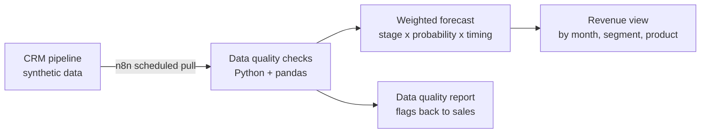

# CRM → RevOps → Finance automation

Turns CRM pipeline data into a clean, weighted revenue forecast that sales, RevOps and finance all trust. Python + n8n on synthetic B2B SaaS data.

## The problem

Sales lives in the CRM, finance lives in spreadsheets. Every forecast cycle someone exports the pipeline, fixes missing close dates and stale stages by hand, applies probabilities in Excel and rebuilds the revenue view. It takes days, every version is slightly different, and by the time the forecast is ready the pipeline has already moved.

## The approach



1. **Data in:** n8n pulls open opportunities from the CRM on a schedule: amount, stage, close date, owner, product, segment. For this repo the CRM is a synthetic dataset of a fictional B2B SaaS company.
2. **Processing:** Python and pandas clean the data (missing or past close dates, stale stages, duplicates), apply stage probabilities, and spread deal value across months based on close date and contract term.
3. **Output:** a weighted revenue forecast by month, segment and product, plus a data quality report listing the deals sales needs to fix.

## The result

Targets on the synthetic dataset:

- **One version of the truth:** sales and finance work from the same pipeline numbers
- **Faster refresh:** from about 5 hours of manual work to under 10 minutes, mostly automated. The time saved goes into aligning with the business and making decisions, not prepping data
- **Cleaner data:** quality issues flagged automatically, not discovered in the forecast review

## Tools

Python, pandas, n8n, CRM REST API, Excel / CSV output

## Run it yourself

Coming soon ...

<!--
```bash
git clone https://github.com/mtuantruong/crm-finance-automation.git
cd crm-finance-automation
python -m venv .venv && source .venv/bin/activate
pip install -r requirements.txt
cp .env.example .env   # add your own API keys here, never commit .env
python src/main.py
```
-->

## Data

All data in `data/` is synthetic and describes a fictional company. It does not reflect any real company.

## License

MIT
